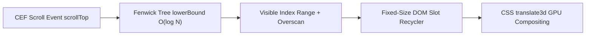

# Fenwick-Tree Virtual List Engine for CEF UI (60 FPS on 50 000+ Dynamic Rows)

Сверхлегкий движок виртуализации списков и таблиц с переменной высотой строк для браузерного интерфейса CEF (RAGE:MP / alt:V), построенный на дереве Фенвика (`Int32Array` Binary Indexed Tree) и пуле переиспользуемых DOM-слотов.

## Архитектура



## Инженерные решения

1. **Дерево Фенвика поверх `Int32Array` (`src/virtualizer/fenwick-height-tree.ts`):**
   Позволяет вычислять префиксную сумму высот, обновлять высоту отдельной строки при раскрытии деталей (`updateDelta`) и находить первый видимый элемент по `scrollTop` (`lowerBound`) за логарифмическое время $O(\log N)$ без выделения памяти на куче.
2. **Нулевые аллокации при скролле (`src/virtualizer/viewport-window.ts`):**
   Массив видимых слотов и объект состояния вьюпорта переиспользуются между кадрами, полностью исключая микрофризы сборщика мусора в Chromium CEF при быстрой прокрутке.
3. **Экономия 99.9% DOM-узлов:**
   Вместо рендера 50 000 строк в DOM поддерживается фиксированное окно из `~32` элементов (видимая область + overscan), позиционируемых через `translate3d`.

## Результаты бенчмарка (50 000 строк, 5 000 кадров скролла)

| Метрика | Значение |
| :--- | :--- |
| **Размер датасета** | `50 000 rows` (переменная высота) |
| **Активных DOM-узлов** | `32` (**экономия 99.936%**) |
| **Среднее время расчета кадра** | **`0.00073 ms`** (бюджет 60 FPS = `16.6 ms`) |
| **Дельта кучи за 5000 кадров (Heap Delta)** | `+27.75 KB` |

## Запуск

```bash
npm install
npm run typecheck
npm run bench
```
